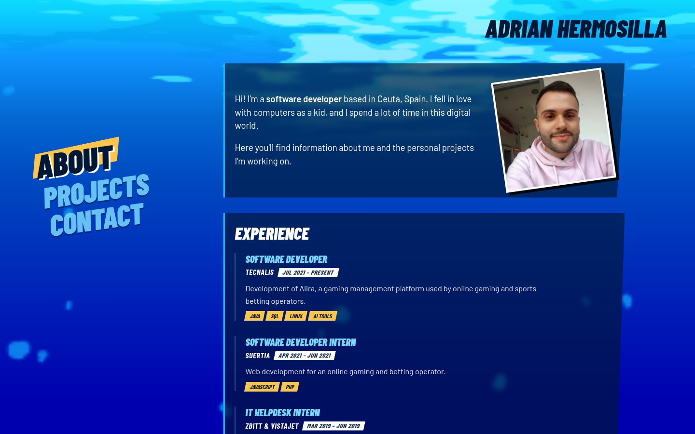
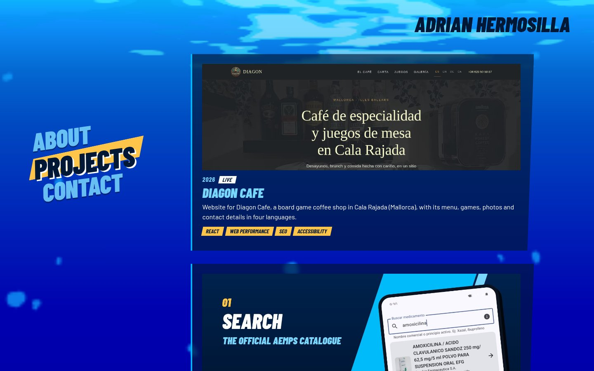
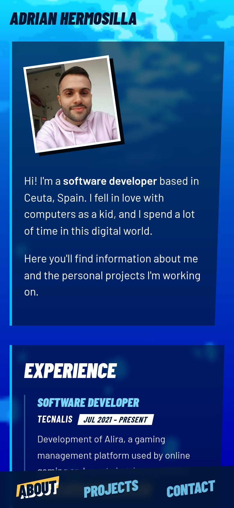
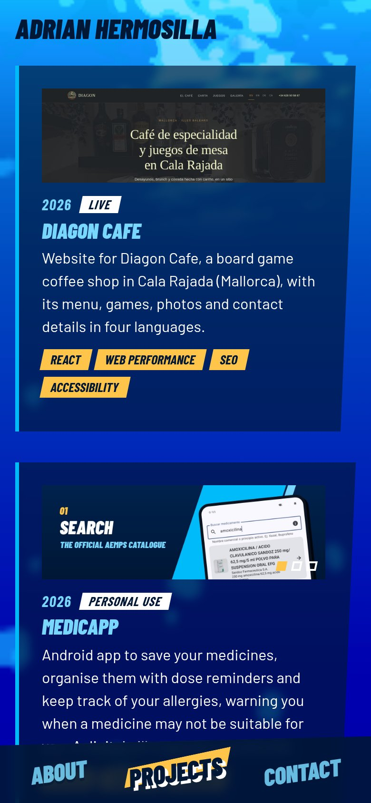
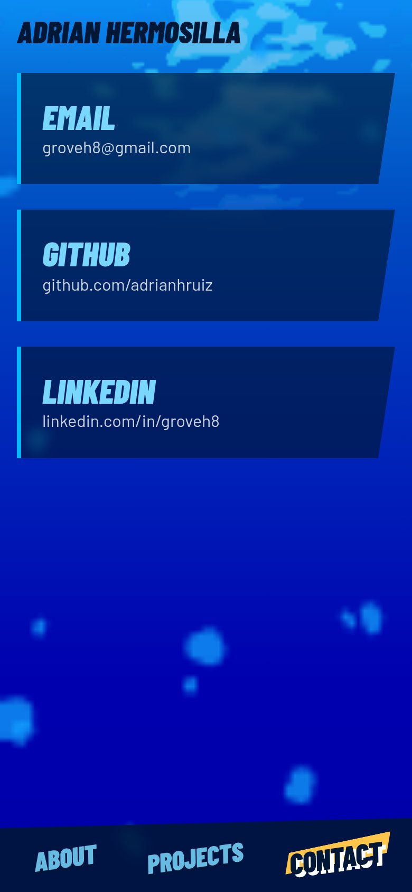

# Persona 3 Reload Portfolio

Personal portfolio inspired by the Persona 3 Reload pause menu: a slanted command menu, an animated
ocean that dives deeper on every section and gold highlights over the blues. Built with Vite + React
and deployed to GitHub Pages.

**Live:** https://adrianhruiz.github.io/portafolio-persona3reload/

## Desktop

The command menu stays on the left, vertically centred, and can be driven with the arrow keys.





## Mobile

On small screens the menu becomes a bottom bar, always within thumb reach.

<p align="center">
  
  
  
</p>

## Development

```bash
npm install
npm run dev
```

## Content

- `src/data/profile.json`: name shown at the top.
- `src/data/projects.json`: the projects.
- `src/sections/About.jsx` and `src/sections/Contact.jsx`: about text, experience, education and
  contact links.

### Adding a project

Add an entry to `src/data/projects.json`:

```json
{
  "title": "My project",
  "year": 2026,
  "status": "Live",
  "description": "What it does, why I built it and what came out of it.",
  "tags": ["react"],
  "repo": "https://github.com/adrianhruiz/my-project",
  "image": ["projects/my-project-1.jpg", "projects/my-project-2.jpg"]
}
```

Every field except `title` is optional. Images go in `public/projects/` and are shown in a 3:1
frame. `image` can be a single path or a list, which turns into a carousel. Clicking the card
opens `repo`.

## Deploy

Every push to `main` builds and publishes the site through `.github/workflows/deploy.yml`.
In the repo settings, set **Pages → Source** to **GitHub Actions**.

The site is served from `/portafolio-persona3reload/`, set as `base` in `vite.config.js`. If the repo
is renamed, update `base` to match.

### Screenshots

The images in `docs/screenshots/` were taken at 1440×900 (desktop) and 390×844 (mobile, 2x).
